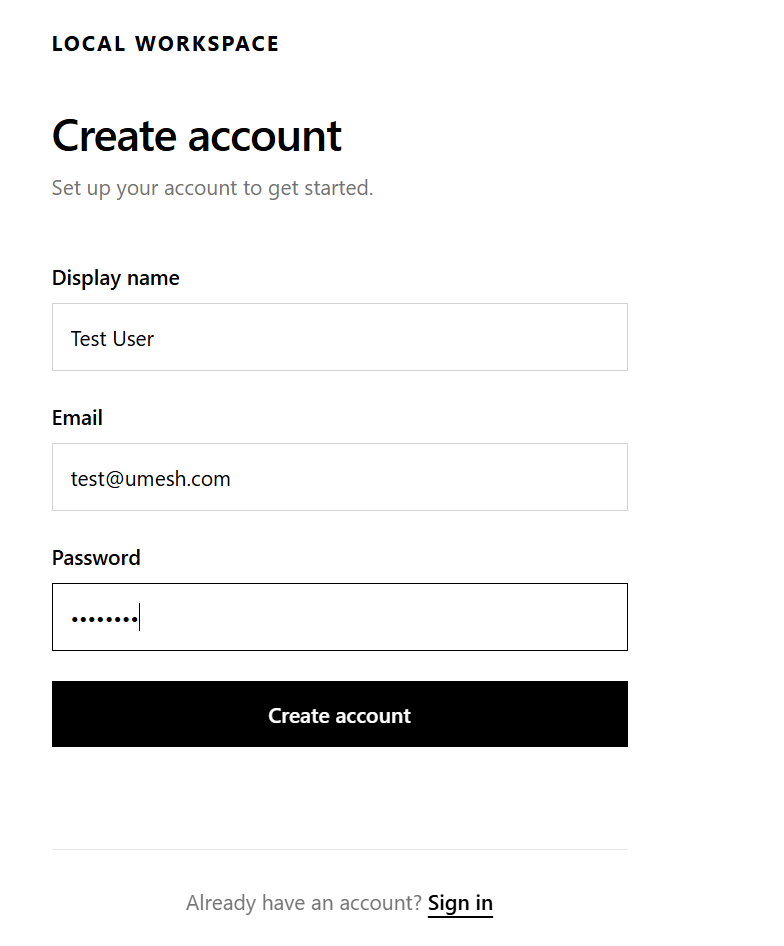
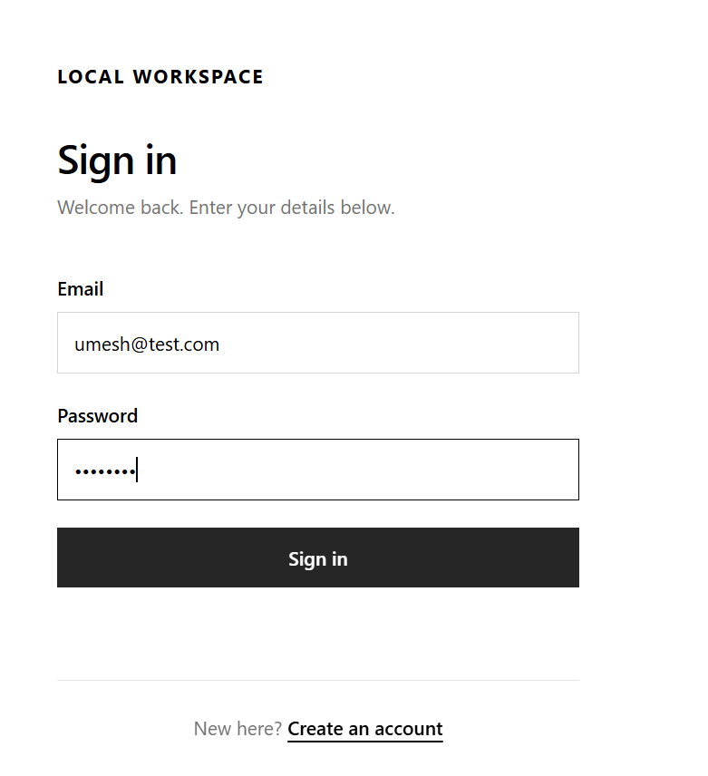
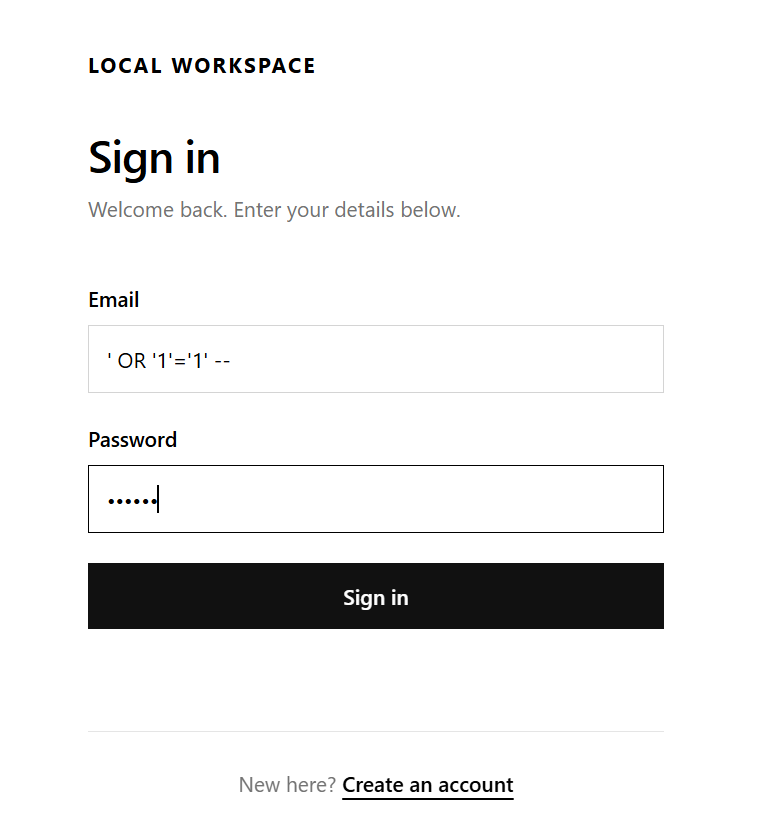
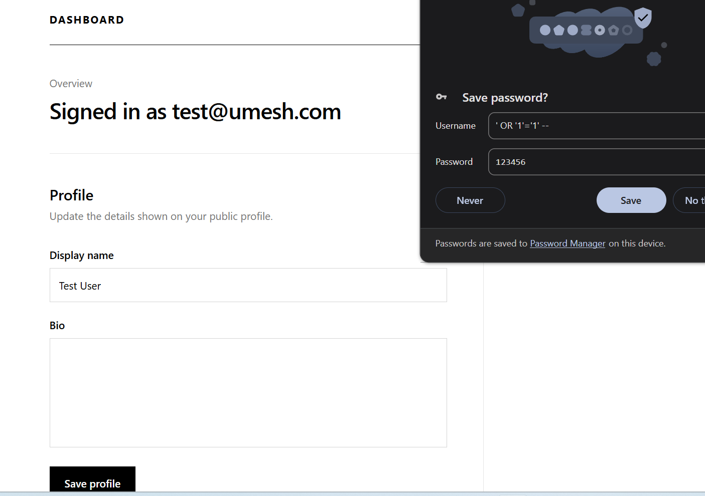
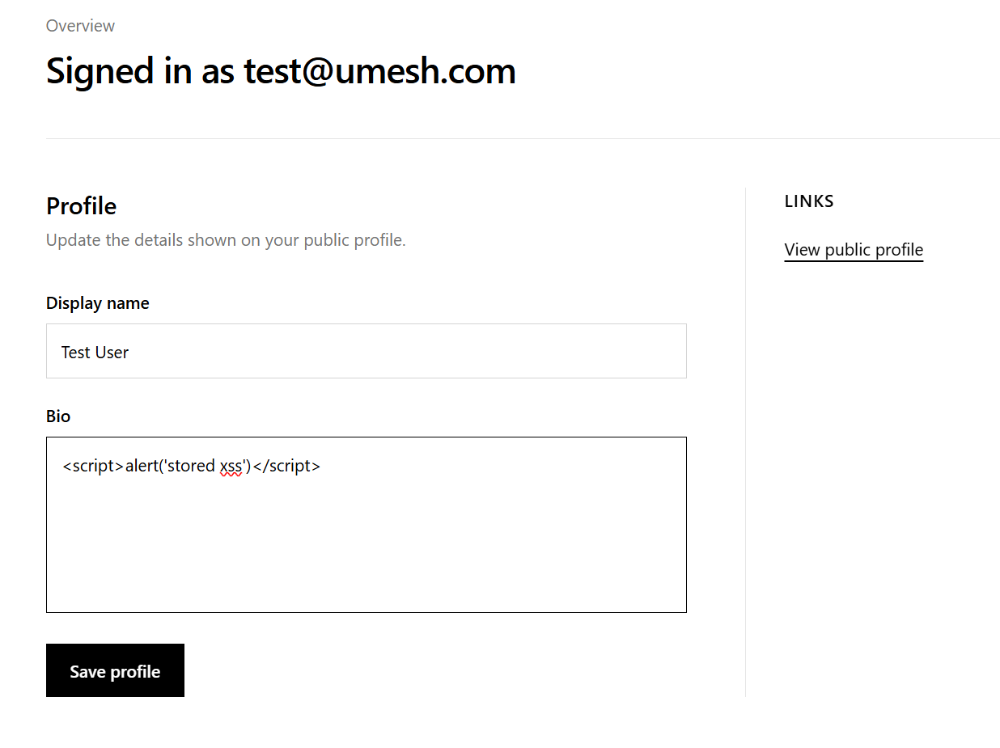
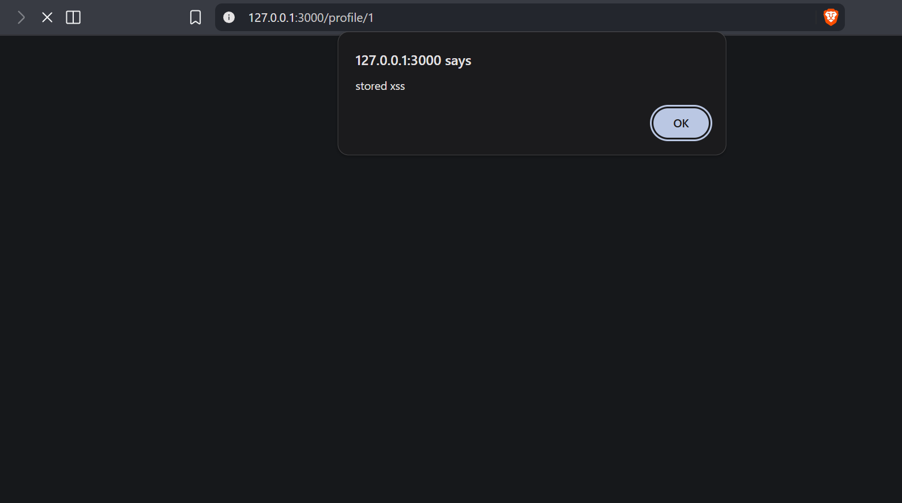
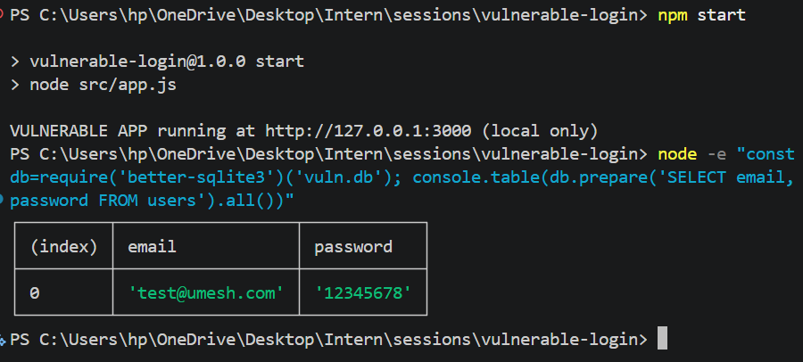
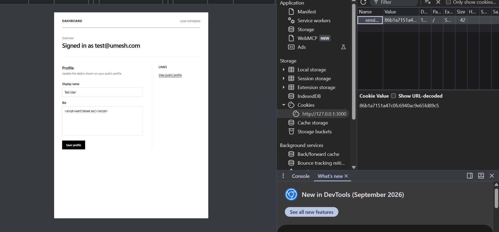

# Authentication Security Lab

> **Warning:** This app is a local training app. Never deploy it or use real
> user data.

This project documents the original vulnerabilities and their fixes:

- SQL injection
- Stored XSS
- Password hashing
- Secure session cookies

## Run the app

Open PowerShell in this folder and run:

```powershell
npm install
npm start
```

Open this URL:

```text
http://127.0.0.1:3000/signup.html
```

Use port `3000`, not Live Server port `5500`.

## Test the normal flow

1. Open `/signup.html`.
2. Create an account.
3. Open `/signin.html` and log in.
4. Update your name and bio on the dashboard.
5. Open your public profile.

## Exploit documentation (before patch)

These tests were performed against the original vulnerable implementation.

### 1. SQL injection

Email:

```text
' OR '1'='1' -- 
```

Password: `anything`

The original query was:

```sql
SELECT * FROM users WHERE email = '' OR '1'='1' -- ' AND password = 'anything'
```

The `--` starts a SQL comment, so the trailing password predicate is ignored.
The query returns the first user and creates a session without checking the
password. In the captured local run, this logged in as the first account
returned by SQLite.

### 2. Stored XSS

Save this as your bio:

```html
<script>alert('XSS: ' + document.cookie)</script>
```

The original profile endpoint inserted `user.name` and `user.bio` directly into
an HTML response. The script executed when the profile was viewed. The alert
showed the session cookie value when the cookie was readable by JavaScript;
an attacker could exfiltrate that value instead of displaying it.

### 3. Password storage and cookies

The original app stored passwords directly in `vuln.db` and sent the session
cookie without `HttpOnly`, `Secure`, or `SameSite` flags.

## Patch

- Login now selects by email using a parameterized query and verifies the
  password separately with bcryptjs.
- Signup stores a bcrypt password hash. Existing local plaintext rows are
  migrated to hashes at startup.
- Profile names and bios are HTML-escaped before interpolation.
- Session cookies use `HttpOnly`, `SameSite=Strict`, and `Secure` by default.
  The checked-in `.env` is intentionally absent; use `.env.example` and set
  `COOKIE_SECURE=false` only for local HTTP.

## Re-verification (after patch)

The exact original attacks were repeated after patching:

1. Email `' OR '1'='1' -- ` with password `anything` returns
   `401 {"success":false}` and does not set a session cookie.
2. Bio `<script>alert('XSS: ' + document.cookie)</script>` is returned in the
   profile response as escaped literal text:
   `&lt;script&gt;alert(&#039;XSS: &#039; + document.cookie)&lt;/script&gt;`.
   No script executes and no alert appears.

Captured patched responses:

```text
POST /login
HTTP/1.1 401 Unauthorized
{"success":false}

GET /profile/2
HTTP/1.1 200 OK
<h1>Proof User's Profile</h1><p>&lt;script&gt;alert(&#039;XSS: &#039; + document.cookie)&lt;/script&gt;</p>
```

To reproduce the checks locally:

```powershell
Invoke-RestMethod -Method Post http://127.0.0.1:3000/login `
  -ContentType 'application/json' `
  -Body '{"email":"'' OR ''1''=''1'' -- ","password":"anything"}'
```

For the XSS check, create a normal account, log in, POST the exact payload to
`/bio`, then request `/profile/<id>` and confirm the response contains escaped
text rather than a `<script>` element.

## Screenshots

### Signup



### Sign in



### SQL injection



### Plaintext password



### Stored XSS input



### Session cookie



### Browser password prompt



This prompt is generated by the browser.

### Stored XSS alert


